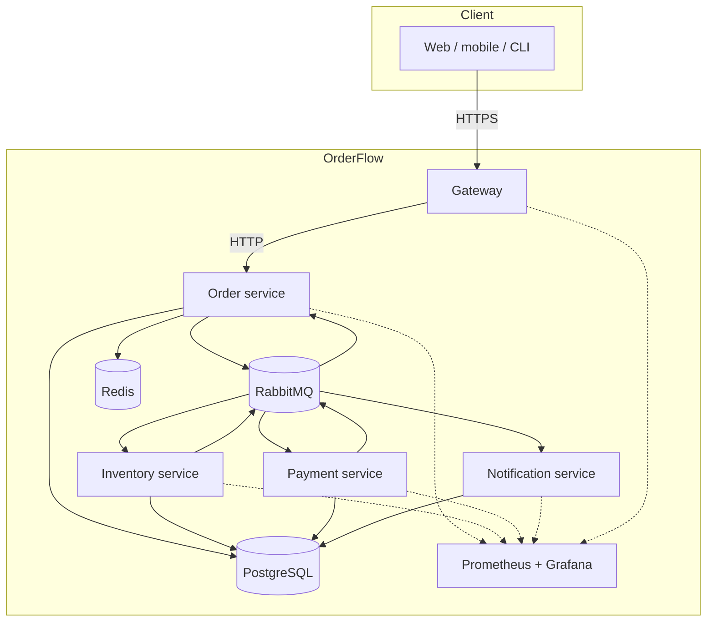
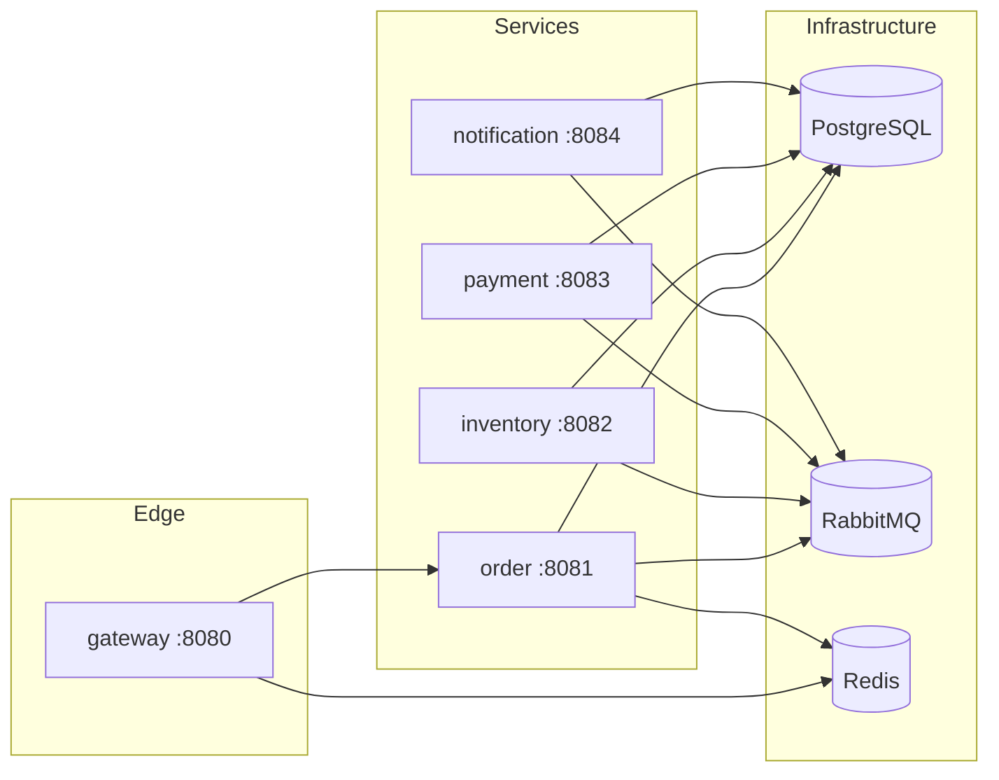
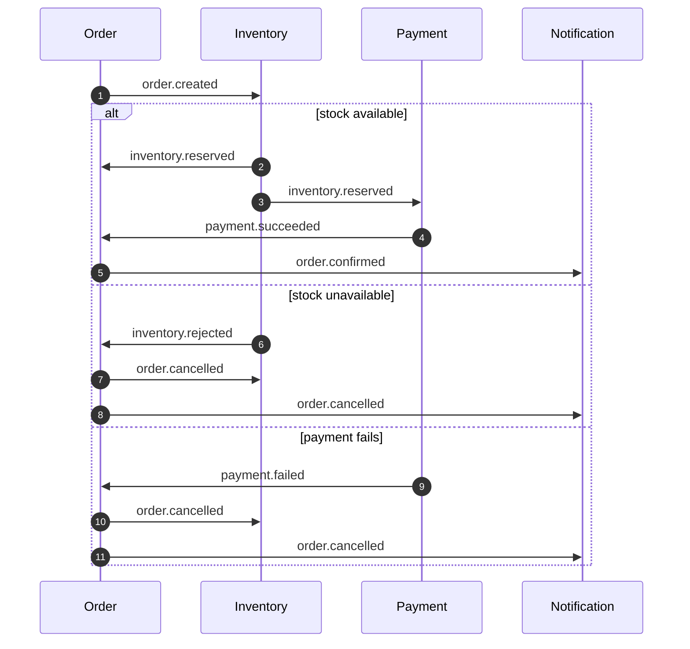

# Architecture

OrderFlow is a small but complete event-driven system. It is intentionally built around the hard parts of distributed order processing rather than around framework features.

## Goals

- Accept orders over a stable HTTP contract.
- Process inventory, payment and notification asynchronously.
- Never lose a committed business change (transactional outbox).
- Never create duplicate orders for the same client retry (idempotency).
- Never oversell stock under concurrency (atomic reservation).
- Recover from partial failures with compensation (saga).
- Isolate poison messages and make them replayable (retry queues and DLQs).
- Expose enough telemetry to operate the system.

## Non-goals

- Real payment provider integration.
- User authentication and authorization.
- Multi-region or active-active deployment.
- Exactly-once delivery. OrderFlow uses at-least-once delivery plus idempotent consumers.
- A reporting read model. The services expose their own APIs; cross-service reporting would need a separate consumer.

## System context



## Service boundaries

| Service | Owns | Does not own |
| --- | --- | --- |
| Gateway | Public routing, rate limiting, request IDs, Swagger | Business state |
| Order | Order aggregate, state machine, idempotency keys, saga decisions | Stock levels, payment state |
| Inventory | Stock levels, reservations, releases | Order status, payment |
| Payment | Payment attempts and simulated captures | Stock, order status |
| Notification | Notification records | Any business decision |

Each service has its own logical database:

- `order_db`
- `inventory_db`
- `payment_db`
- `notification_db`

In local development these are four databases on one PostgreSQL instance. In a real deployment they would be separate instances or clusters. No service queries another service's tables.

## Runtime topology



Only the gateway is exposed publicly. The order service exposes an internal HTTP API for reads and writes; the other services expose only health and metrics endpoints.

## Consistency model

OrderFlow does not use distributed transactions. It uses four mechanisms together:

1. **Local ACID transactions.** A service commits its business row and an outbox row in the same PostgreSQL transaction.
2. **Transactional outbox.** A relay publishes committed outbox rows to RabbitMQ with publisher confirms.
3. **At-least-once delivery.** RabbitMQ may deliver a message more than once, especially after a crash between publish and acknowledgement.
4. **Idempotent consumers.** Each consumer records `(consumer, event_id)` in `processed_events` inside the same transaction as its business change. Redelivery is acknowledged without repeating the side effect.

The result is **eventual consistency**: an order is accepted immediately in `PENDING`, then moves to `RESERVED`, `PAID` and `CONFIRMED` as events are processed.

### Write path

```mermaid
sequenceDiagram
    autonumber
    participant C as Client
    participant G as Gateway
    participant O as Order service
    participant DB as order_db
    participant R as Outbox relay
    participant MQ as RabbitMQ

    C->>G: POST /v1/orders (Idempotency-Key)
    G->>O: proxy request
    O->>DB: SELECT order by idempotency_key
    alt key already used
        DB-->>O: existing order
        O-->>C: 201 existing order
    else new key
        O->>DB: BEGIN; INSERT order; INSERT outbox; COMMIT
        DB-->>O: committed
        O-->>C: 201 PENDING order
        R->>DB: SELECT unpublished outbox FOR UPDATE SKIP LOCKED
        R->>MQ: publish order.created (confirm)
        MQ-->>R: ack
        R->>DB: UPDATE outbox SET published_at = now()
    end
```

The HTTP response does not wait for inventory or payment. The order is durable as soon as the local transaction commits.

## Data ownership and schemas

### Order service

| Table | Purpose |
| --- | --- |
| `orders` | Aggregate state, total, version, idempotency key |
| `order_items` | Immutable line items |
| `order_history` | Status transitions with event IDs |
| `outbox` | Events to publish |
| `processed_events` | Consumer inbox |

The `orders` table has a unique index on `idempotency_key`. The `version` column increments on every state transition and gives clients a monotonic version; concurrent transitions are serialized with `SELECT ... FOR UPDATE` row locks.

### Inventory service

| Table | Purpose |
| --- | --- |
| `inventory` | `available` and `reserved` counters per SKU, with non-negative checks |
| `reservations` | One row per `(order_id, sku)`, with status |
| `outbox` | Reservation and release events |
| `processed_events` | Consumer inbox |

Reservation is a single conditional update:

```sql
UPDATE inventory
SET available = available - $2,
    reserved  = reserved + $2,
    version   = version + 1,
    updated_at = now()
WHERE sku = $1 AND available >= $2;
```

If zero rows are updated, the reservation is rejected. This is atomic under concurrent transactions and enforced by the database, not by application-level locking.

### Payment service

| Table | Purpose |
| --- | --- |
| `payments` | Payment attempt, amount, status, simulated provider reference |
| `outbox` | Payment result events |
| `processed_events` | Consumer inbox |

The payment service consumes `inventory.reserved`, simulates a provider call with `PAYMENT_FAILURE_RATE`, records the attempt, and emits `payment.succeeded` or `payment.failed`.

### Notification service

| Table | Purpose |
| --- | --- |
| `notifications` | Rendered notification per order and event |
| `processed_events` | Consumer inbox |

Notification is a pure consumer. It never publishes events, so it has no outbox table.

## Saga

OrderFlow uses an orchestration-free saga coordinated by the order service's state machine.



Compensation is explicit: `order.cancelled` tells inventory to release any reservation it holds. Inventory's release operation is idempotent, so a duplicate cancellation cannot double-release stock.

Because `order.created` and `order.cancelled` travel through different queues, a cancellation can arrive at inventory before the creation event. Inventory closes that race with two mechanisms:

- A `cancelled_orders` tombstone is written by the cancellation path.
- Reservation and cancellation take a PostgreSQL transaction-scoped advisory lock keyed by `order_id`, so they are serialized per order.

If cancellation wins, the later creation event sees the tombstone and skips reservation. If reservation wins, the cancellation sees the reservation and releases it.

The saga has no timeout coordinator. An order can remain in `PENDING` or `RESERVED` if a downstream service is down for a long time; the event stays in RabbitMQ and is retried. A production system would add a reconciliation job for orders stuck beyond an SLA. A payment captured just before a customer cancellation is also not refunded; that requires a real payment-provider compensation flow.

## Failure handling

| Failure | Behavior |
| --- | --- |
| Process crashes before outbox commit | No order and no event; the client retries with the same idempotency key |
| Process crashes after commit, before publish | Relay publishes on the next tick |
| Process crashes after publish, before marking published | Event is published again; consumers deduplicate |
| Consumer crashes before ack | RabbitMQ redelivers; inbox deduplicates |
| Transient consumer error (DB down, timeout) | Message goes to a retry queue with a TTL, then returns to the main exchange |
| Retry budget exhausted | Message goes to the consumer DLQ |
| Permanent error (invalid payload, unsupported type) | Message goes straight to the DLQ |
| Redis unavailable | Idempotency falls back to the database unique constraint; rate limiting fails open |
| RabbitMQ unavailable | Services fail readiness; outbox rows accumulate and are published when the broker returns |
| Payment provider failure | `payment.failed` cancels the order and releases stock |

Retry and DLQ names are deterministic:

- Retry: `<queue>--<routing-key>.retry`
- DLQ: `<queue>.dlq`

## Concurrency and ordering

RabbitMQ does not guarantee global ordering. OrderFlow does not depend on it:

- Each order has a state machine that only accepts valid transitions.
- `ApplyEvent` checks the order's current status and ignores stale or duplicate events.
- The `version` column and status history record what actually happened.
- Inventory reservation is atomic at the row level.
- Inventory serializes reservation and cancellation per order with a transaction-scoped advisory lock, and records cancellation tombstones.

Consumers use a prefetch of 20 and process deliveries sequentially per channel. This bounds memory and gives predictable per-message latency. Scale throughput by adding service replicas, not by unbounded concurrency in one process.

## Observability

Every service registers a per-process Prometheus registry. The gateway adds HTTP metrics through middleware. Domain counters are incremented in the order and inventory use cases, and the outbox relay exposes backlog. Consumers record consumed events, retries and DLQ moves.

The Grafana dashboard is provisioned from `deploy/docker/grafana/dashboards/orderflow.json`.

## Security posture

Implemented:

- Non-root distroless containers in Docker.
- Non-root, read-only-root-filesystem pods in Kubernetes.
- Default-deny NetworkPolicies.
- No secrets in source; `.env.example` and Kubernetes Secret contain development placeholders.
- Idempotency keys and rate limiting at the edge.
- Request IDs and correlation IDs for auditability.

Not implemented (intentionally out of scope):

- Authentication and authorization.
- TLS termination and mTLS between services.
- Secret management (Vault, Sealed Secrets, cloud secret manager).
- Per-client quotas and API keys.
- Audit log export.

These are documented as production gaps rather than hidden behind a demo.

## Trade-offs

| Choice | Benefit | Cost |
| --- | --- | --- |
| Outbox + relay | No dual-write data loss | Extra table, polling latency, at-least-once semantics |
| Inbox table | Safe redelivery | Extra write per event |
| One database per service | Clear ownership | No joins; reporting requires a read model |
| Saga instead of 2PC | Availability and simplicity | Temporary inconsistency and compensating actions |
| Redis idempotency cache | Fast duplicate response | Cache is not authoritative; database constraint is the backstop |
| Simulated payment | Self-contained demo | Not a production payment integration |
| Polling outbox | Simple and robust | Up to one polling interval of extra latency |
