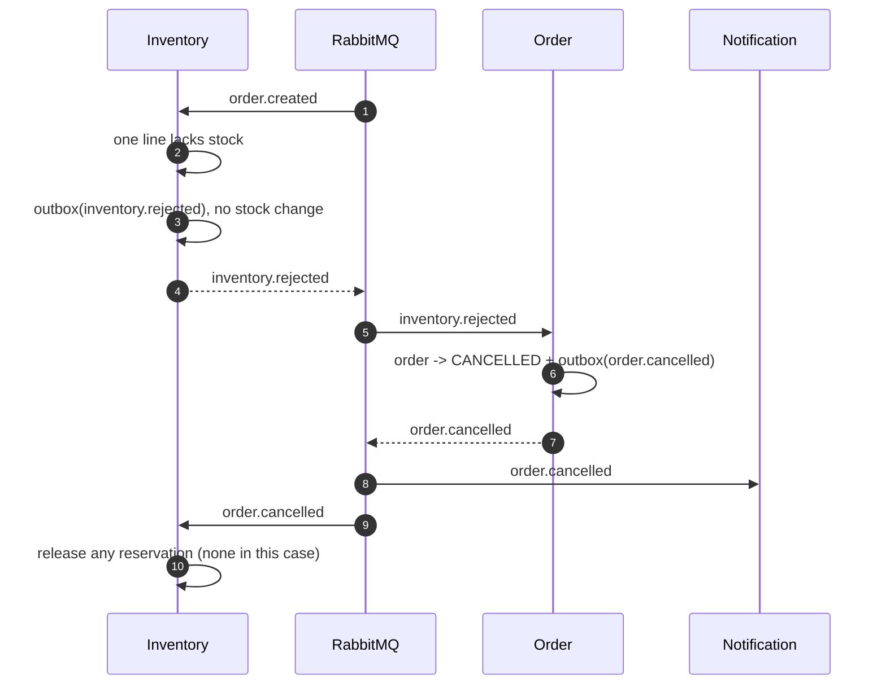
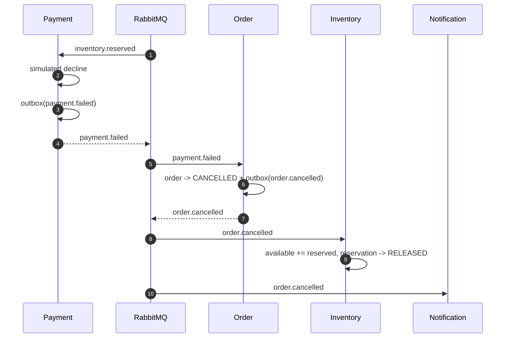

# Event Flow

This document describes every message OrderFlow publishes, who consumes it, and how failures are handled.

## Envelope

All messages share one envelope. Payloads are versioned independently through `event_version`.

```json
{
  "event_id": "7b9d3f2e-4c1a-4a6e-9f0d-2b8c5e1a3d47",
  "event_type": "order.created",
  "event_version": 1,
  "occurred_at": "2026-01-01T12:00:00Z",
  "producer": "order-service",
  "correlation_id": "3f1c2a9e-8b7d-4c6a-9e1f-2d3c4b5a6f70",
  "causation_id": "",
  "payload": {
    "order_id": "0e4b9d8c-4a4e-4f2b-9a5c-5e7d8f9a0b1c",
    "customer_id": "cust-42",
    "currency": "EUR",
    "items": [
      { "sku": "SKU-1", "quantity": 2, "unit_price_cents": 1999 }
    ],
    "total_cents": 3998
  }
}
```

- `event_id` is generated with UUID v4 and is the idempotency key for consumers.
- `correlation_id` is propagated from the incoming HTTP request.
- `causation_id` points at the event that caused this event (for example, `inventory.reserved` caused by `order.created`).
- `producer` identifies the emitting service.
- `occurred_at` is set when the envelope is created, not when the row is relayed.

## Event catalog

| Event | Producer | Consumers | Payload |
| --- | --- | --- | --- |
| `order.created` | order | inventory | `order_id`, `customer_id`, `currency`, `items[]`, `total_cents` |
| `inventory.reserved` | inventory | order, payment | `order_id`, `reservation_id`, `total_cents`, `currency` |
| `inventory.rejected` | inventory | order | `order_id`, `sku`, `reason` |
| `inventory.released` | inventory | none (audit/extension point) | `order_id` |
| `payment.succeeded` | payment | order | `order_id`, `payment_id` |
| `payment.failed` | payment | order | `order_id`, `reason` |
| `order.confirmed` | order | notification | `order_id`, `customer_id` |
| `order.cancelled` | order | inventory, notification | `order_id`, `customer_id`, `reason` |

`inventory.released` is emitted when stock is actually released. No service consumes it today; it exists so a future analytics or audit consumer can subscribe without changing inventory.

## Happy path

```mermaid
sequenceDiagram
    autonumber
    participant C as Client
    participant G as Gateway
    participant O as Order
    participant DB as order_db
    participant MQ as RabbitMQ
    participant I as Inventory
    participant P as Payment
    participant N as Notification

    C->>G: POST /v1/orders + Idempotency-Key
    G->>O: proxy
    O->>DB: BEGIN; INSERT order + outbox(order.created); COMMIT
    O-->>C: 201 PENDING
    DB-->>MQ: relay publishes order.created
    MQ->>I: order.created
    I->>I: reserve all lines atomically + outbox(inventory.reserved)
    I-->>MQ: relay publishes inventory.reserved
    MQ->>O: inventory.reserved
    O->>DB: order -> RESERVED + inbox
    MQ->>P: inventory.reserved
    P->>P: simulate capture + outbox(payment.succeeded)
    P-->>MQ: relay publishes payment.succeeded
    MQ->>O: payment.succeeded
    O->>DB: order -> PAID -> CONFIRMED + outbox(order.confirmed)
    O-->>MQ: relay publishes order.confirmed
    MQ->>N: order.confirmed
    N->>N: store notification + inbox
```

Notes:

- The order service may observe `payment.succeeded` before or after it processes `inventory.reserved`; the state machine only accepts the transition once.
- `payment.succeeded` is applied with targets `PAID` and `CONFIRMED`, so a fast consumer can move the order directly to `CONFIRMED` if the intermediate `PAID` transition was not separately recorded.
- Notification runs after the order is terminal, so it is safe to retry.

## Inventory rejection



The inventory service rejects the **whole order** if any line cannot be reserved. It checks all lines under `FOR UPDATE` before applying updates, so a partially reserved order is not possible.

## Payment failure



`PAYMENT_FAILURE_RATE` controls the simulated decline rate. Setting it to `1.0` makes the compensation path deterministic for demos and tests.

## Customer cancellation

```mermaid
sequenceDiagram
    autonumber
    participant C as Client
    participant O as Order
    participant DB as order_db
    participant MQ as RabbitMQ
    participant I as Inventory
    participant N as Notification

    C->>O: POST /v1/orders/{id}/cancel
    O->>DB: check state; reject if CONFIRMED
    O->>DB: order -> CANCELLED + outbox(order.cancelled)
    O-->>C: 200 CANCELLED
    DB-->>MQ: relay publishes order.cancelled
    MQ->>I: order.cancelled
    I->>I: release reservations if any
    MQ->>N: order.cancelled
```

Cancellation is idempotent: if the order is already `CANCELLED`, the service returns it without emitting another event. A `CONFIRMED` order cannot be cancelled and returns `409 Conflict`.

### Cancellation before reservation

`order.created` and `order.cancelled` are consumed from different queues, so the cancellation can reach inventory first. Inventory handles this with:

1. A transaction-scoped advisory lock keyed by `order_id`, shared by reservation and cancellation.
2. A `cancelled_orders` tombstone written by the cancellation path.

If cancellation wins the lock, the later `order.created` sees the tombstone and does not reserve stock. If reservation wins, the cancellation sees the reservation and releases it. The advisory lock prevents the check-then-act race between the two transactions.

## Queue topology

Each consumer declares:

- One durable main queue.
- One durable retry queue per routing key.
- One durable DLQ.

```text
exchange: orderflow.events (topic, durable)

inventory.order-created
  bound: order.created
  retry: inventory.order-created--order.created.retry
  dlq:   inventory.order-created.dlq

inventory.order-cancelled
  bound: order.cancelled
  retry: inventory.order-cancelled--order.cancelled.retry
  dlq:   inventory.order-cancelled.dlq

payment.inventory-events
  bound: inventory.reserved
  retry: payment.inventory-events--inventory.reserved.retry
  dlq:   payment.inventory-events.dlq

order.inventory-events
  bound: inventory.reserved, inventory.rejected
  retry: order.inventory-events--inventory.reserved.retry
  retry: order.inventory-events--inventory.rejected.retry
  dlq:   order.inventory-events.dlq

order.payment-events
  bound: payment.succeeded, payment.failed
  retry: order.payment-events--payment.succeeded.retry
  retry: order.payment-events--payment.failed.retry
  dlq:   order.payment-events.dlq

notification.order-events
  bound: order.confirmed, order.cancelled
  retry: notification.order-events--order.confirmed.retry
  retry: notification.order-events--order.cancelled.retry
  dlq:   notification.order-events.dlq
```

Retry queues have `x-message-ttl` set to `RETRY_TTL` (default 5 seconds) and dead-letter back to the main exchange with the original routing key. This means a retried message re-enters the normal exchange path and can be consumed by any replica.

## Retry policy

1. Handler returns `nil`: acknowledge.
2. Handler returns a transient error: read `x-retry-count`.
   - If `retries >= MAX_RETRIES`, publish to the DLQ and acknowledge.
   - Otherwise publish to the retry queue with `x-retry-count + 1` and `x-last-error`, then acknowledge.
3. Handler returns a permanent error (`rabbitmq.Permanent`): publish to the DLQ immediately and acknowledge.
4. Invalid envelope: publish to the DLQ immediately.

If publishing the retry or DLQ message fails, the original delivery is `Nack`ed with `requeue=true`, so RabbitMQ redelivers it.

## Idempotency and deduplication

Consumers insert `(consumer, event_id)` into `processed_events` with `ON CONFLICT DO NOTHING` inside the same transaction as the business change:

- If the insert affects zero rows, the event was already processed. The consumer commits and acknowledges.
- If the business change fails, the transaction rolls back, including the inbox row. The message is retried later.

This gives **effectively-once side effects** while keeping **at-least-once delivery**. The inbox is per service, not global.

## Event versioning

- `event_version` starts at `1`.
- Additive payload fields are backward compatible and do not require a version bump.
- Breaking changes require a new event type or a new version with consumers supporting both.
- `events.Decode[T]` ignores unknown JSON fields, which makes additive changes safe for older consumers.
- The outbox stores the full envelope as JSONB, so replaying an old event preserves its original version.

## Ordering guarantees

RabbitMQ preserves order per queue, but OrderFlow has multiple queues and multiple consumers, so there is no global order. The system is designed for that:

- The order state machine rejects invalid transitions.
- `ApplyEvent` records the event ID in the status history and ignores events that would move the order backwards.
- Inventory reservation is atomic and keyed by `(order_id, sku)`.
- Inventory serializes reservation and cancellation per order with an advisory lock.
- Payment is keyed by order and deduplicated by the inbox.

If strict per-order ordering were required, a single queue per order or a partitioned stream (for example Kafka with a partition key) would be a better fit.
